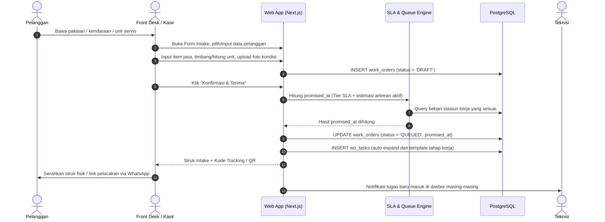
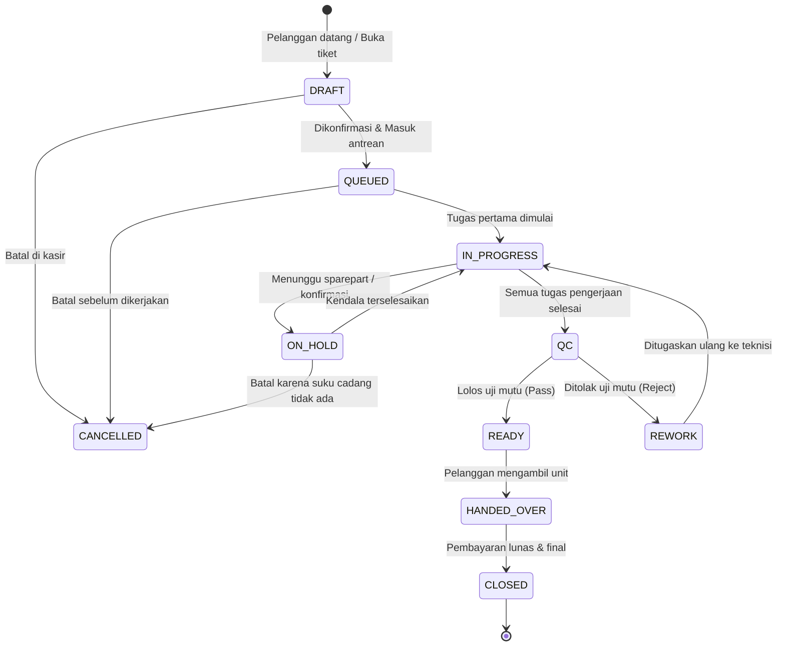
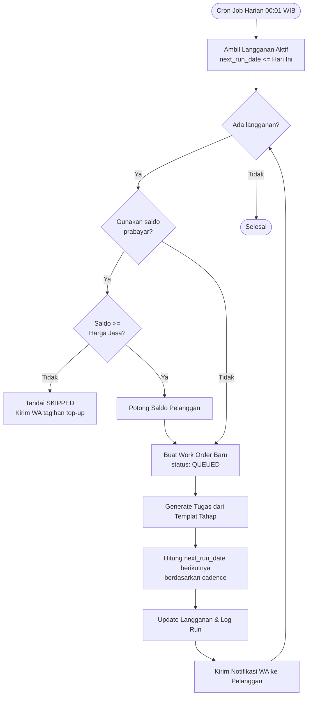

# Product Requirements Document (PRD)
## ERP Berbasis Web untuk Usaha Jasa (Laundry, Bengkel, dan Service Center)

**Versi**: 1.2 (Penerapan Hak Akses Peran & Atribusi Aktor)  
**Status**: Draft Disetujui  
**Tanggal**: 2026  

---

## 1. Executive Summary & Vision

### 1.1 Ringkasan Produk
Produk ini adalah sistem **ERP Berbasis Web yang Ringan (Lightweight)**, dirancang khusus untuk usaha yang **menjual jasa dan waktu, bukan barang fisik**: laundry kiloan & satuan, bengkel kendaraan, depot servis AC, service center elektronik, studio foto, dan jasa servis umum lainnya.

Diferensiasi utamanya dari ERP dagang/retail terletak pada **objek transaksi inti**. ERP barang menggunakan `SalesOrder` sebagai tulang punggung dokumen. ERP jasa menggunakan **`WorkOrder` (WO) / tiket pekerjaan** sebagai tulang punggung — sebuah unit kerja yang harus melewati **tahap kerja (stage)**, dikerjakan oleh **teknisi** pada **stasiun kerja (station)**, melewati **quality control (QC)**, lalu diserahkan kepada pelanggan.

| Aspek | ERP Barang (existing) | ERP Jasa (produk ini) |
| :--- | :--- | :--- |
| Dokumen inti | `SalesOrder` | `WorkOrder` (WO / tiket kerja) |
| Batas kapasitas | Stok fisik barang | **Waktu & kapasitas teknisi** |
| Objek yang dijual | SKU dengan satuan unit | **Skill + durasi + konsumable** |
| Sumber margin | Selisih harga jual vs HPP | **Margin per job** (pendapatan - part - tenaga) |
| Titik kegagalan | Stok habis / over-selling | **Job telat, salah tahap, hilang, atau dobel pengerjaan** |
| Metrik kunci | Inventory turnover, stockout | **SLA attainment, throughput, utilisasi teknisi** |

### 1.2 Masalah yang Diselesaikan
1. **Blind spot pada progres pekerjaan.** Pelanggan menanyakan "sudah sampai mana?", staf membuka tumpukan nota atau grup WhatsApp tanpa jawaban pasti.
2. **Kapasitas teknisi tidak terukur.** Tidak ada data berapa jam produktif per teknisi, seberapa dalam antrean, dan stasiun mana yang menjadi bottleneck.
3. **Janji tenggat (SLA) tanpa data.** Janji estimasi selesai ditentukan pakai feeling, bukan dari kapasitas dan antrean nyata.
4. **Biaya job tidak terlacak.** Faktur terbit tanpa kepastian berapa margin bersih setelah dikurangi suku cadang/konsumable dan komisi teknisi.
5. **Mutu tidak terukur.** Pekerjaan cacat diperbaiki ulang tanpa sistem mencatat alasan, akar masalah, atau frekuensi kesalahan.
6. **Pelanggan berulang tidak terpantau.** Paket langganan (laundry mingguan, servis AC berkala) tidak terjadwal otomatis, rentan churn.
7. **Pekerjaan macet akibat kehabisan bahan & suku cadang (Stockout).** Bahan kimia laundry atau suku cadang servis bengkel habis mendadak di tengah pengerjaan WO karena pengadaan tidak terencana, tidak ada reorder point otomatis, dan ketiadaan data riwayat lead time pemasok.

### 1.3 Solusi yang Ditawarkan
1. **Intake Terstruktur dengan Bukti.** Setiap barang/unit yang masuk dicatat dengan nomor WO unik, checklist kondisi awal, dan foto bukti fisik sebelum disentuh.
2. **Routing Otomatis Berdasar Tahap.** Setiap jenis jasa memiliki templat tahap kerja; sistem memecah WO menjadi tugas-tugas terurut, lalu menugaskannya ke stasiun dan teknisi yang cocok skill-nya.
3. **Papan Produksi Visual (Job Board).** Papan kanban real-time yang memetakan seluruh pekerjaan dari antrean, sedang dikerjakan, menunggu QC, hingga siap serah-terima.
4. **SLA Otomatis & Dynamic Lead Time.** Janji selesai dihitung dari durasi standar + kedalaman antrean saat intake, lengkap dengan indikator visual keterlambatan.
5. **Job Costing Otomatis.** Setiap part/konsumable yang terpakai dan komisi teknisi dikaitkan langsung ke WO untuk menghitung margin bersih riil per pekerjaan.
6. **Paket Berulang (Subscription Scheduler).** Menjadwalkan WO secara otomatis untuk pelanggan rutin, dengan pemotongan saldo prabayar dan notifikasi WhatsApp.
7. **Manajemen Rantai Pasok (Supply & Procurement) Terintegrasi.** Pengadaan operasional suku cadang & bahan: deteksi stok minimum, pembuatan Purchase Request (PR), penerbitan Purchase Order (PO) ke pemasok, penerimaan barang bertahap (GRN), retur barang cacat, transfer antar-cabang, dan pelacakan pembayaran hutang pembelian (AP).

### 1.4 Tujuan Bisnis & Key Performance Indicators (KPIs)
* **Transparansi Progres 100%:** Setiap WO memiliki kode pelacakan publik yang dapat dicek pelanggan kapan saja.
* **SLA Attainment >= 90%:** Minimal 90% pekerjaan diserahkan tepat pada atau sebelum waktu yang dijanjikan.
* **First-Time-Right (FTR) >= 95%:** Minimal 95% pekerjaan lolos inspeksi QC pada percobaan pertama.
* **Utilisasi Teknisi 75-85%:** Waktu kerja teknisi teralokasi pada tugas produktif, menghindari overwork maupun idle time.
* **Margin Terbaca per Job:** Setiap WO yang ditutup menampilkan angka pendapatan, biaya part, biaya tenaga kerja, dan margin kotor nominal serta persentase.
* **Retensi Langganan >= 85%:** Pelanggan paket berkala terpelihara secara otomatis tiap siklus.

---

## 2. Domain Principles & Batasan Lingkup

### 2.1 Prinsip Domain (Domain Principles)
* **P1 - WO adalah Transactional Backbone.** Satu-satunya jalan pekerjaan masuk ke sistem adalah melalui `WorkOrder`. Tidak ada faktur, komisi, maupun laporan tanpa nomor WO.
* **P2 - Kapasitas adalah Batasan Nyata.** Stasiun dan teknisi memiliki batasan jam dan slot paralel per hari. Antrean dan SLA dihitung dari beban nyata, bukan asumsi flat.
* **P3 - Semua Perubahan Status Terdokumentasi.** Transisi status wajib mencatat aktor, waktu, dan alasan bila terjadi pembatalan atau pengerjaan ulang (rework).
* **P4 - Bukti Fisik Mendahului Klaim.** Foto sebelum pengerjaan, foto sesudah, dan checklist inspeksi adalah bagian inti dari data WO untuk melindungi dari sengketa.
* **P5 - Konsumable & Suku Cadang Diadakan untuk Mendukung Jasa.** Sparepart dan bahan operasional diadakan via rantai pasok resmi (PO/GRN), disimpan per cabang, dimutasi antar-cabang, dan dikonsumsi ke WO. Barang tidak dijual eceran terpisah (bukan toko ritel murni tanpa jasa).
* **P6 - QC adalah Gerbang Wajib.** Tidak ada status `HANDED_OVER` tanpa melalui validasi `QC` (kecuali jasa yang secara eksplisit tidak mewajibkan QC).
* **P7 - Reversibilitas Tercatat.** Dokumen tidak dihapus (no hard delete) - pembatalan status dilakukan dengan pencatatan audit log lengkap.

### 2.2 Batasan Lingkup (Out of Scope)
* **General Ledger / Akuntansi Penuh:** Tidak mencakup pembukuan jurnal ganda (double-entry GL penuh), penyusunan neraca lajur, atau laporan arus kas formal. Fokus pada *Job Costing*, pencatatan hutang pembelian operasional (AP sederhana), dan omzet operasional.
* **Pajak Kompleks:** Hanya mendukung tarif persentase flat (PPN sederhana) tanpa pembuatan e-Faktur resmi DJP atau 3-Way Matching faktur pajak formal.
* **Penggajian / Payroll Formal:** Hanya menghitung akrual komisi teknisi, tidak mengelola BPJS, PPh 21, atau potongan pinjaman.
* **Aplikasi Native:** Sistem dibangun sebagai Web App responsif (PWA ready), tidak ada aplikasi native Android/iOS khusus pada fase awal.
* **Inbound Bot WA Otomatis:** Integrasi WhatsApp pada versi awal hanya mengirim template pesan keluar (outbound), bukan percakapan AI bot dua arah.

---

## 3. Rekomendasi Tech Stack

> **Status: Rekomendasi Arsitektur.** Model domain dirancang bebas dari keterikatan framework (framework-agnostic). Rekomendasi berikut diselaraskan dengan standar arsitektur modern dan portofolio proyek serupa.

| Lapisan | Komponen Rekomendasi | Pertimbangan Teknis |
| :--- | :--- | :--- |
| **Frontend Framework** | Next.js 15 (App Router, React 19, TypeScript) | Server Component untuk pemuatan cepat, arsitektur modular, SSR |
| **Styling & UI** | Tailwind CSS + Shadcn UI (Radix Primitives) | UI bersih, responsif, aksesibel, dan mudah dikustomisasi |
| **State & Data Fetching** | TanStack Query v5 + Zustand | Caching data server, sinkronisasi state lokal tanpa reload |
| **Papan Kanban** | @hello-pangea/dnd atau TanStack Virtual | Drag-and-drop tugas di Job Board yang mulus |
| **Backend / API** | Next.js Route Handlers + Server Actions | Satu repositori (monorepo sederhana), type-safety ujung-ke-ujung |
| **Validasi Skema** | Zod | Validasi ketat pada form, payload API, dan transisi status |
| **Database** | PostgreSQL 16 | Relasi teruji, dukungan JSONB untuk checklist dinamis, index parsial |
| **ORM** | Prisma ORM (atau Drizzle ORM) | Skema deklaratif, migrasi otomatis, query type-safe |
| **Cache & Queue** | Redis (Upstash / Redis Standalone) | Penguncian stok part konkuren, antrean scheduler, session |
| **Object Storage** | S3-Compatible (Cloudflare R2 / MinIO / S3) | Penyimpanan foto kondisi unit, bukti pengerjaan, dan berkas nota |
| **Cetak Dokumen** | @react-pdf/renderer | Pembuatan PDF struk/nota dan faktur secara server-side |
| **Wadah / Deployment** | Docker + Docker Compose | Setup satu perintah (docker compose up), reproducible di server mana pun |

---

## 4. Matriks Peran & Hak Akses (RBAC)

| Peran (Role) | Hak Akses Utama | Batasan & Privilese |
| :--- | :--- | :--- |
| **Owner / Super Admin** | Akses penuh seluruh modul, konfigurasi tarif, master data, audit trail, rekap margin, persetujuan PO nilai besar, dan kelola user. | Tidak ada batasan. Satu-satunya peran yang dapat menghapus master data. |
| **Supervisor / Manajer** | Memantau Job Board, override alokasi teknisi, kelola antrean/SLA, menyetujui rework, persetujuan PR & PO cabang, verifikasi penyesuaian stok selisih besar, melihat laporan performa. | Tidak dapat mengubah tarif dasar global, tidak dapat mengubah pengaturan integrasi sistem. |
| **Front Desk / Kasir** | Input intake WO baru, pencarian pelanggan, serah-terima unit, cetak nota, catat pembayaran, kirim notifikasi WA. | Tidak dapat mengubah harga yang sudah terkunci, tidak dapat melihat rincian HPP / margin kotor, tidak dapat membuat dokumen pengadaan PO. |
| **Teknisi** | Melihat daftar tugas mandiri, mengubah status tugas (Start/Pause/Done), isi checklist, upload foto sebelum/sesudah, minta alokasi part ke WO. | Hanya dapat melihat tugas miliknya; tidak dapat melihat data pelanggan lain, harga jual, harga beli part, margin, atau modul pengadaan. |
| **Quality Control (QC)** | Antrean inspeksi, verifikasi checklist mutu, putusan Lolos/Tolak, penentuan tahap pengerjaan ulang (rework), verifikasi mutu fisik barang masuk (GRN). | Tidak dapat mengubah nominal tagihan; tidak dapat melompati checklist wajib. |
| **Staff Gudang / Purchasing (Parts)** | Kelola katalog pemasok, buat Purchase Request (PR) & Purchase Order (PO), penerimaan barang (GRN), retur barang cacat ke pemasok, transfer stok antar-cabang, opname stok fisik, konfirmasi part ke WO. | Tidak dapat mengubah data pelanggan atau membuat WO secara langsung; PO di atas ambang batas nominal wajib disetujui Supervisor/Owner. |
| **Finance** | Mencatat realisasi pembayaran ke pemasok (supplier AP), memantau faktur jatuh tempo, rekap kas masuk & keluar, mengelola saldo deposit prabayar pelanggan. | Tidak dapat mengubah status pengerjaan teknis atau hasil inspeksi QC. |

### 4.1 Atribusi Aktor pada Dokumen & Antarmuka

Setiap interaksi transaksional mencatat identitas pengguna (`user_id`) dan peran (`role`) aktif saat aksi dilakukan. Sistem tidak lagi menggunakan string anonim: antarmuka menampilkan nama pengguna beserta badge peran pada kolom **"Diajukan Oleh"**, **"Disetujui Oleh"**, **"Diterbitkan Oleh"**, dan **"Diterima Oleh"**.

| Dokumen & Kolom | Peran yang Berhak Mengisi | Tampilan Kolom pada UI | Validasi Sistem |
| :--- | :--- | :--- | :--- |
| `purchase_requests.submitted_by` | `PARTS`, `SUPERVISOR`, `OWNER` | `Nama Pengguna` + badge peran (mis. *Hendra Saputra · Gudang*) | Otomatis terisi saat aksi "Ajukan" ditekan. |
| `purchase_requests.reviewed_by` | `SUPERVISOR`, `OWNER` | `Nama Pengguna` + badge peran (mis. *Agus Pratama · Supervisor*) | Wajib disetujui manual; tombol Setujui/Tolak hanya muncul untuk `SUPERVISOR` atau `OWNER`. |
| `purchase_orders.issued_by` | `PARTS`, `SUPERVISOR`, `OWNER` | `Nama Pengguna` + badge peran | Terisi saat PO diubah statusnya menjadi `ORDERED`. |
| `goods_receipts.received_by` | `PARTS`, `SUPERVISOR`, `OWNER` | `Nama Pengguna` + badge peran | Terisi saat penerimaan barang fisik diposting. |
| `goods_receipts.inspected_by` | `QC`, `PARTS`, `SUPERVISOR`, `OWNER` | `Nama Pengguna` + badge peran | Terisi saat hasil inspeksi mutu dicatat. |
| `stock_transfers.created_by` | `PARTS`, `SUPERVISOR`, `OWNER` | `Nama Pengguna` + badge peran | Terisi saat transfer antar cabang diajukan. |
| `supplier_payments.paid_by` | `FINANCE`, `OWNER` | `Nama Pengguna` + badge peran | Tombol pencatatan pembayaran hanya tersedia bagi Finance/Owner. |
| `work_orders.created_by` | `FRONT_DESK`, `SUPERVISOR`, `OWNER` | `Nama Pengguna` + badge peran | Terisi saat tiket WO masuk antrean produksi. |

### 4.2 Navigasi Berbasis Peran

Menu samping (sidebar) secara dinamis memfilter modul sesuai peran aktif:
- **Teknisi**: Hanya dapat melihat menu *Dashboard* dan *Tugas Saya* (tampilan mobile-first terfokus). Seluruh modul finansial, margin, dan pengadaan disembunyikan.
- **Front Desk**: Memiliki akses ke *Dashboard*, *Intake Baru*, *Job Board*, *Work Orders*, *Serah-Terima & Kasir*, dan *Langganan*. Modul pengadaan/stok dan detail HPP disembunyikan.
- **Staff Gudang (Parts)**: Memiliki akses ke *Dashboard*, *Bahan & Kartu Stok*, *Katalog Pemasok*, *Purchase Request*, *Purchase Orders*, *Penerimaan GRN*, dan *Transfer Cabang*.
- **Finance**: Memiliki akses ke *Dashboard*, *Work Orders*, *Serah-Terima & Kasir*, *Purchase Orders* (pelunasan AP), dan *Laporan*.
- **Supervisor & Owner**: Memiliki visibilitas penuh terhadap seluruh modul dan hak aksi persetujuan.

---

## 5. Spesifikasi Master Data

### 5.1 Cabang (Branch)
Mendukung operasional multi-cabang sejak awal:
* `code`: Kode cabang unik (mis. `JKT-01`, `BDG-02`).
* `name`, `address`, `phone`: Informasi kontak cabang.
* `timezone`: Zona waktu (default `Asia/Jakarta`).
* `open_time`, `close_time`: Jam operasional untuk menghitung waktu pengerjaan SLA.
* `doc_prefix`: Awalan nomor dokumen (mis. `WO-BDG`).
* `is_default`: Penanda cabang utama.

### 5.2 Katalog Jasa (Service) & Templat Tahap
Setiap jasa mendefinisikan cara kerja dan perhitungan biayanya:
* **Jasa (Service):**
  * `code`, `name`, `category` (mis. `Laundry Kiloan`, `Cuci Sepatu`, `Tune-Up`, `Servis AC`).
  * `base_unit`: Satuan ukuran (`kg`, `pcs`, `unit`, `jam`).
  * `price_type`: `PER_UNIT` (harga per satuan), `FLAT` (harga pasti), `PER_HOUR` (tarif jam), `TIERED` (berdasarkan volume).
  * `base_price`: Tarif dasar.
  * `requires_qc`: Apakah hasil akhir wajib diverifikasi staf QC (Boolean).
  * `is_addon`: Apakah jasa dapat ditambahkan di tengah pengerjaan (mis. ganti oli tambahan).
* **Templat Tahap (ServiceStageTemplate):**
  * `seq`: Urutan tahap (1, 2, 3, dst).
  * `code`: Kode tahap (mis. `INTAKE_CHECK`, `WASH`, `DRY`, `IRON`, `PACK`, `FINAL_QC`).
  * `name`: Nama label tahap.
  * `required_skill`: Keahlian minimal yang dibutuhkan (mis. `cucin`, `mekanik_mesin`).
  * `station_pref`: Kode stasiun default.
  * `est_minutes`: Perkiraan waktu pengerjaan standar.
  * `is_qc_stage`: Menandai apakah tahap ini adalah inspeksi mutu.
* **Butir Checklist (ServiceChecklistItem):**
  * Checklist verifikasi per tahap (mis. "Periksa saku celana", "Pastikan baut roda kencang 100 Nm").
  * `is_mandatory`: Wajib dicentang sebelum tugas bisa berstatus selesai.

### 5.3 Stasiun Kerja (Station)
Titik fisik tempat pekerjaan berlangsung:
* `code`, `name`, `branch_id`.
* `parallel_capacity`: Jumlah pengerjaan simultan (mis. Mesin Cuci 10kg = 1, Lift Bengkel = 1, Meja Lipat = 2).
* `daily_hours`: Jam kerja operasional stasiun per hari.
* `required_skill`: Batasan jenis pengerjaan pada stasiun ini.

### 5.4 Teknisi (Technician)
Tenaga pelaksana pekerjaan:
* `code`, `full_name`, `phone`, `branch_id`.
* `skills`: Array teks tag keahlian (mis. `['cuci_satuan', 'leather_care', 'qc']`).
* `daily_hours`: Jam kerja aktif per hari.
* `commission_mode`: Cara hitung komisi (`FLAT_PER_JOB`, `PERCENTAGE_OF_REVENUE`, `TIERED_PER_HOUR`).
* `commission_rate`: Nilai rate komisi (nominal atau persentase).

### 5.5 Pelanggan & Paket Langganan
* **Pelanggan (Customer):**
  * `code`, `name`, `phone` (format E.164: `628...`), `email`, `address`.
  * `type`: `WALK_IN` (anonim/sekali lewat), `TERDAFTAR` (member), `KONTRAK` (B2B/perusahaan).
  * `prepaid_balance`: Saldo deposit prabayar untuk sistem potong kuota/saldo.
  * `notes`: Catatan preferensi permanen (mis. "Alergi pewangi melati", "Mobil ceper hati-hati hidrolik").
* **Langganan (Subscription):**
  * Jadwal berulang: frekuensi (`WEEKLY`, `BIWEEKLY`, `MONTHLY`, `CUSTOM_DAYS`).
  * Kuota/jumlah unit per siklus, hari jemput, hari antar.
  * Opsi potong saldo prabayar otomatis.

### 5.6 Sparepart & Konsumable (Part)
Bahan penunjang jasa yang dibeli melalui rantai pasok resmi, disimpan per cabang, lalu dipotong saat pekerjaan berjalan:
* **Katalog (Master):**
  * `code`, `name`, `category` (mis. `Bahan Kimia`, `Suku Cadang`, `Pelumas`).
  * `unit` (`ml`, `pcs`, `liter`, `meter`) &mdash; satuan pemakaian saat konsumsi ke WO.
  * `purchase_unit` &mdash; satuan pembelian dari pemasok (mis. pembelian per `dus`, dipakai per `pcs`).
  * `conversion_ratio` &mdash; pengali konversi pembelian ke pemakaian (mis. 1 `dus` = 24 `pcs`, maka `24`).
  * `unit_cost` &mdash; harga pokok rata-rata bergerak (moving average) hasil pembukuan `goods_receipts`.
  * `default_supplier_id` &mdash; pemasok baku untuk kebutuhan Emergency Reorder.
  * `reorder_point` &mdash; titik pesan ulang; memicu peringatan & draft PR otomatis.
  * `reorder_qty` &mdash; jumlah pesan yang disarankan saat titik pesan terlampaui.
  * `is_active` &mdash; penanda barang aktif (barang lama tidak dihapus,see `P7`).
* **Stok (Per Cabang):**
  * `stock_qty` &mdash; jumlah stok riil per cabang.
  * `min_stock` &mdash; ambang batas minimum stok per cabang.
  * `max_stock` &mdash; batas atas penyimpanan (indikasi overstock, opsional).

### 5.6.1 Pemasok (Supplier)
Rekanan pemasok bahan habis pakai & suku cadang:
* `code`, `name`, `phone`, `email`, `address`.
* `pic_name` &mdash;(point of contact) nama person in charge sourcing.
* `term_of_payment` &mdash; termin pembayaran dalam hari (TOP, mis. `30` hari sejak GRN).
* `lead_time_days` &mdash; rata-rata hari kerja dari PO diterbitkan hingga barang tiba (dasar perhitungan jadwal `expected_at`).
* `rating` &mdash; penilaian kinerja pemasok (1&ndash;5) untuk keperluan MDM.
* `bank_details` &mdash; data rekening untuk transfer pembayaran.
* `is_active` &mdash; penanda pemasok aktif.

### 5.7 Aturan Harga (PricingRule)
Fleksibilitas penentuan harga tanpa mengubah master data jasa:
* Berdasarkan tier kuantitas (mis. 1–4 kg = Rp10.000/kg; >= 5 kg = Rp8.000/kg).
* Berdasarkan pelanggan khusus (diskon kemitraan B2B).
* Periode tanggal berlaku (harga promo / peak season).

### 5.8 Kebijakan SLA (SlaPolicy)
* Tingkat kecepatan: `REGULAR`, `EXPRESS`, `SAME_DAY`.
* `base_duration_hours`: Jam kerja standar untuk menyelesaikan pekerjaan.
* `slack_ratio`: Ambang batas waktu aman sebelum memicu peringatan sistem (default: 20%).

---

## 6. Model Data Relasional (PostgreSQL)

```sql
-- ============================================================
-- ENUMERASI SISTEM
-- ============================================================

CREATE TYPE wo_status AS ENUM (
  'DRAFT',           -- Intake dalam proses, belum dikunci
  'QUEUED',          -- Diterima & masuk antrean produksi
  'IN_PROGRESS',     -- Minimal satu tugas sedang dikerjakan
  'ON_HOLD',         -- Tertahan (menunggu part, persetujuan pelanggan)
  'QC',              -- Seluruh pengerjaan selesai, menunggu uji mutu
  'REWORK',          -- Ditolak QC, dikembalikan ke tahap tertentu
  'READY',           -- Mutu lolos, siap diambil/diantar
  'HANDED_OVER',     -- Barang telah diserahkan ke pelanggan
  'CLOSED',          -- Pembayaran lunas & siklus transaksi selesai
  'CANCELLED'        -- Dibatalkan
);

CREATE TYPE task_status AS ENUM (
  'PENDING',         -- Belum dialokasikan / menunggu giliran
  'ASSIGNED',        -- Sudah ada teknisi & stasiun, siap mulai
  'IN_PROGRESS',     -- Sedang dikerjakan
  'PAUSED',          -- Jeda sementara
  'BLOCKED',         -- Macet (butuh part/kendala teknis)
  'DONE',            -- Selesai dikerjakan
  'QC_REJECTED'      -- Ditolak saat QC, butuh perbaikan
);

CREATE TYPE photo_kind AS ENUM (
  'INTAKE',          -- Kondisi fisik saat diterima di kasir
  'PRE_STAGE',       -- Kondisi sebelum tahap tertentu dimulai
  'POST_STAGE',      -- Hasil setelah suatu tahap selesai
  'QC_REJECT',       -- Bukti kerusakan/kekurangan saat ditolak QC
  'DELIVERY'         -- Bukti serah-terima ke pelanggan
);

CREATE TYPE payment_status AS ENUM (
  'UNPAID', 'PARTIALLY_PAID', 'PAID', 'REFUNDED'
);

CREATE TYPE payment_method AS ENUM (
  'CASH', 'TRANSFER', 'QRIS', 'CARD', 'PREPAID_BALANCE', 'DEBT'
);

CREATE TYPE subscription_cadence AS ENUM (
  'WEEKLY', 'BIWEEKLY', 'MONTHLY', 'CUSTOM_DAYS'
);

CREATE TYPE commission_mode AS ENUM (
  'FLAT_PER_JOB', 'PERCENTAGE_OF_REVENUE', 'TIERED_PER_HOUR'
);

CREATE TYPE audit_action AS ENUM (
  'STATUS_CHANGE', 'TASK_UPDATE', 'PRICE_OVERRIDE',
  'PART_CONSUMED', 'REWORK_TRIGGERED', 'PAYMENT_RECEIVED', 'CANCEL',
  'PR_SUBMITTED', 'PR_APPROVED', 'PR_REJECTED', 'PO_ISSUED', 'PO_CANCELLED',
  'GRN_RECEIVED', 'GRN_INSPECTED', 'SUPPLIER_RETURN_ISSUED', 'STOCK_ADJUSTED',
  'STOCK_TRANSFERRED', 'SUPPLIER_PAYMENT_RECORDED'
);

-- ============================================================
-- ENUMERASI RANTAI PASOK (PENGADAAN)
-- ============================================================

CREATE TYPE pr_status AS ENUM (
  'DRAFT',          -- Permintaan disusun (dipicu reorder otomatis atau manual)
  'SUBMITTED',      -- Diajukan ke penyetuju
  'APPROVED',       -- Disetujui, siap dikonversi jadi PO
  'REJECTED',       -- Ditolak penyetuju
  'PO_CREATED'      -- Sudah menjadi Purchase Order
);

CREATE TYPE po_status AS ENUM (
  'DRAFT',              -- PO disusun, belum dikirim ke pemasok
  'ORDERED',            -- Sudah dikirim / dikonfirmasi pemasok
  'PARTIALLY_RECEIVED', -- Sebagian barang telah diterima (GRN parsial)
  'RECEIVED',           -- Seluruh barang telah diterima (GRN penuh)
  'CANCELLED'           -- Dibatalkan (sebelum/sesudah PUB sebagian)
);

CREATE TYPE grn_status AS ENUM (
  'PENDING_INSPECTION',  -- Barang datang, menunggu verifikasi mutu/koli
  'INSPECTED_PASS',      -- Sesuai, stok & tagihan diterima
  'INSPECTED_REJECT',    -- Tidak sesuai -> sebagian/total dialihkan ke retur
  'CANCELLED'            -- DIBatalkan saat inspeksi
);

CREATE TYPE supplier_return_status AS ENUM (
  'DRAFT',              -- Retur disusun
  'PENDING_PICKUP',     -- Menunggu pengambilan barang oleh pemasok
  'COMPLETED',          -- Barang kadaluarsa/pengembalian selesai
  'REJECTED_BY_SUPPLIER'-- Pemasok menolak pengembalian
);

CREATE TYPE stock_movement_type AS ENUM (
  'PURCHASE_RECEIPT',   -- Stok bertambah dari GRN
  'JOB_CONSUMPTION',    -- Stok berkurang karena dipakai di WO
  'SUPPLIER_RETURN',    -- Stok berkurang karena retur dari pemasangan
  'RETURN_OUT',         -- Stok berkurang karena retur ke pemasok
  'TRANSFER_OUT',       -- Stok keluar untuk dikirim ke cabang lain
  'TRANSFER_IN',        -- Stok masuk diterima dari cabang lain
  'ADJUSTMENT_PLUS',    -- Penyesuaian positif (opname, ditemukan lebih)
  'ADJUSTMENT_MINUS'    -- Penyesuaian negatif (opname kurang, kadaluwarsa/rusak)
);

CREATE TYPE supplier_payment_status AS ENUM (
  'UNPAID', 'PARTIALLY_PAID', 'PAID'
);

CREATE TYPE transfer_status AS ENUM (
  'DRAFT',           -- Permintaan transfer disusun
  'IN_TRANSIT',      -- Barang dikirim, belum diterima cabang tujuan
  'COMPLETED',       -- Diterima cabang tujuan, stok bertambah
  'CANCELLED'        -- Dibatalkan sebelum dikirim
);

-- ============================================================
-- MASTER CABANG & PENGGUNA
-- ============================================================

CREATE TABLE branches (
  id                UUID PRIMARY KEY DEFAULT gen_random_uuid(),
  code              VARCHAR(20) NOT NULL UNIQUE,
  name              VARCHAR(100) NOT NULL,
  address           TEXT,
  phone             VARCHAR(25),
  timezone          VARCHAR(50) NOT NULL DEFAULT 'Asia/Jakarta',
  open_time         TIME NOT NULL DEFAULT '08:00',
  close_time        TIME NOT NULL DEFAULT '20:00',
  is_default        BOOLEAN NOT NULL DEFAULT FALSE,
  doc_prefix        VARCHAR(10) NOT NULL DEFAULT 'WO',
  created_at        TIMESTAMPTZ NOT NULL DEFAULT now(),
  updated_at        TIMESTAMPTZ NOT NULL DEFAULT now()
);

CREATE TABLE users (
  id                UUID PRIMARY KEY DEFAULT gen_random_uuid(),
  branch_id         UUID REFERENCES branches(id),
  email             VARCHAR(150) NOT NULL UNIQUE,
  full_name         VARCHAR(100) NOT NULL,
  password_hash     VARCHAR(255) NOT NULL,
  role              VARCHAR(30) NOT NULL CHECK (role IN (
                      'OWNER','SUPERVISOR','FRONT_DESK','TECHNICIAN','QC','FINANCE','PARTS'
                    )),
  technician_id     UUID,
  is_active         BOOLEAN NOT NULL DEFAULT TRUE,
  created_at        TIMESTAMPTZ NOT NULL DEFAULT now()
);

-- ============================================================
-- MASTER LAYANAN, STASIUN & TEKNISI
-- ============================================================

CREATE TABLE stations (
  id                UUID PRIMARY KEY DEFAULT gen_random_uuid(),
  branch_id         UUID NOT NULL REFERENCES branches(id),
  code              VARCHAR(30) NOT NULL,
  name              VARCHAR(100) NOT NULL,
  parallel_capacity INT NOT NULL DEFAULT 1,
  daily_hours       NUMERIC(4,1) NOT NULL DEFAULT 8.0,
  required_skill    VARCHAR(50),
  is_active         BOOLEAN NOT NULL DEFAULT TRUE,
  UNIQUE(branch_id, code)
);

CREATE TABLE technicians (
  id                UUID PRIMARY KEY DEFAULT gen_random_uuid(),
  branch_id         UUID NOT NULL REFERENCES branches(id),
  code              VARCHAR(30) NOT NULL UNIQUE,
  full_name         VARCHAR(100) NOT NULL,
  phone             VARCHAR(25),
  skills            TEXT[] NOT NULL DEFAULT '{}',
  daily_hours       NUMERIC(4,1) NOT NULL DEFAULT 8.0,
  commission_mode   commission_mode NOT NULL DEFAULT 'FLAT_PER_JOB',
  commission_rate   NUMERIC(12,2) NOT NULL DEFAULT 0,
  is_active         BOOLEAN NOT NULL DEFAULT TRUE,
  created_at        TIMESTAMPTZ NOT NULL DEFAULT now()
);

CREATE TABLE services (
  id                UUID PRIMARY KEY DEFAULT gen_random_uuid(),
  code              VARCHAR(30) NOT NULL UNIQUE,
  name              VARCHAR(150) NOT NULL,
  category          VARCHAR(50) NOT NULL,
  description       TEXT,
  base_unit         VARCHAR(20) NOT NULL DEFAULT 'pcs',
  price_type        VARCHAR(20) NOT NULL DEFAULT 'PER_UNIT',
  base_price        NUMERIC(14,2) NOT NULL DEFAULT 0,
  requires_qc       BOOLEAN NOT NULL DEFAULT TRUE,
  is_addon          BOOLEAN NOT NULL DEFAULT FALSE,
  is_active         BOOLEAN NOT NULL DEFAULT TRUE,
  created_at        TIMESTAMPTZ NOT NULL DEFAULT now()
);

CREATE TABLE service_stage_templates (
  id                UUID PRIMARY KEY DEFAULT gen_random_uuid(),
  service_id        UUID NOT NULL REFERENCES services(id) ON DELETE CASCADE,
  seq               INT NOT NULL,
  code              VARCHAR(30) NOT NULL,
  name              VARCHAR(100) NOT NULL,
  required_skill    VARCHAR(50) NOT NULL,
  station_pref      VARCHAR(30),
  est_minutes       INT NOT NULL DEFAULT 15,
  is_qc_stage       BOOLEAN NOT NULL DEFAULT FALSE,
  UNIQUE (service_id, seq)
);

CREATE TABLE service_checklist_items (
  id                UUID PRIMARY KEY DEFAULT gen_random_uuid(),
  stage_template_id UUID NOT NULL REFERENCES service_stage_templates(id) ON DELETE CASCADE,
  seq               INT NOT NULL,
  label             VARCHAR(255) NOT NULL,
  is_mandatory      BOOLEAN NOT NULL DEFAULT TRUE
);

-- ============================================================
-- MASTER PELANGGAN & SUBSCRIPTION
-- ============================================================

CREATE TABLE customers (
  id                UUID PRIMARY KEY DEFAULT gen_random_uuid(),
  code              VARCHAR(30) NOT NULL UNIQUE,
  name              VARCHAR(150) NOT NULL,
  phone             VARCHAR(25),
  email             VARCHAR(150),
  address           TEXT,
  type              VARCHAR(20) NOT NULL DEFAULT 'TERDAFTAR',
  notes             TEXT,
  prepaid_balance   NUMERIC(14,2) NOT NULL DEFAULT 0,
  created_at        TIMESTAMPTZ NOT NULL DEFAULT now()
);

CREATE TABLE subscriptions (
  id                UUID PRIMARY KEY DEFAULT gen_random_uuid(),
  code              VARCHAR(30) NOT NULL UNIQUE,
  customer_id       UUID NOT NULL REFERENCES customers(id) ON DELETE RESTRICT,
  service_id        UUID NOT NULL REFERENCES services(id),
  branch_id         UUID NOT NULL REFERENCES branches(id),
  cadence           subscription_cadence NOT NULL DEFAULT 'WEEKLY',
  custom_days       INT,
  quantity          NUMERIC(10,2) NOT NULL DEFAULT 1,
  pickup_day        SMALLINT CHECK (pickup_day BETWEEN 1 AND 7),
  delivery_day      SMALLINT CHECK (delivery_day BETWEEN 1 AND 7),
  use_prepaid       BOOLEAN NOT NULL DEFAULT TRUE,
  next_run_date     DATE NOT NULL,
  is_active         BOOLEAN NOT NULL DEFAULT TRUE,
  created_at        TIMESTAMPTZ NOT NULL DEFAULT now()
);

CREATE TABLE subscription_runs (
  id                UUID PRIMARY KEY DEFAULT gen_random_uuid(),
  subscription_id   UUID NOT NULL REFERENCES subscriptions(id) ON DELETE CASCADE,
  scheduled_date    DATE NOT NULL,
  work_order_id     UUID,
  status            VARCHAR(20) NOT NULL CHECK (status IN ('GENERATED','SKIPPED','FAILED')),
  note              TEXT,
  created_at        TIMESTAMPTZ NOT NULL DEFAULT now(),
  UNIQUE (subscription_id, scheduled_date)
);

-- ============================================================
-- ATURAN HARGA & KEBIJAKAN SLA
-- ============================================================

CREATE TABLE pricing_rules (
  id                UUID PRIMARY KEY DEFAULT gen_random_uuid(),
  service_id        UUID NOT NULL REFERENCES services(id) ON DELETE CASCADE,
  customer_id       UUID REFERENCES customers(id) ON DELETE CASCADE,
  min_qty           NUMERIC(10,2) NOT NULL DEFAULT 0,
  max_qty           NUMERIC(10,2),
  unit_price        NUMERIC(14,2) NOT NULL,
  valid_from        DATE NOT NULL DEFAULT CURRENT_DATE,
  valid_to          DATE,
  is_active         BOOLEAN NOT NULL DEFAULT TRUE
);
CREATE INDEX idx_pricing_lookup ON pricing_rules (service_id, customer_id, is_active);

CREATE TABLE sla_policies (
  id                UUID PRIMARY KEY DEFAULT gen_random_uuid(),
  code              VARCHAR(30) NOT NULL,
  name              VARCHAR(100) NOT NULL,
  branch_id         UUID REFERENCES branches(id) ON DELETE CASCADE,
  tier              VARCHAR(20) NOT NULL CHECK (tier IN ('SAME_DAY','EXPRESS','REGULAR')),
  base_hours        NUMERIC(6,2) NOT NULL,
  slack_ratio       NUMERIC(3,2) NOT NULL DEFAULT 0.20,
  is_default        BOOLEAN NOT NULL DEFAULT FALSE
);

-- ============================================================
-- TRANSAKSI WORK ORDER (TULANG PUNGGUNG)
-- ============================================================

CREATE TABLE work_orders (
  id                UUID PRIMARY KEY DEFAULT gen_random_uuid(),
  wo_no             VARCHAR(50) NOT NULL UNIQUE,
  branch_id         UUID NOT NULL REFERENCES branches(id),
  customer_id       UUID REFERENCES customers(id),
  customer_name     VARCHAR(150) NOT NULL,
  customer_phone    VARCHAR(25),
  entry_channel     VARCHAR(20) NOT NULL DEFAULT 'WALK_IN',
  status            wo_status NOT NULL DEFAULT 'DRAFT',
  sla_tier          VARCHAR(20) NOT NULL DEFAULT 'REGULAR',
  priority          INT NOT NULL DEFAULT 3,
  promised_at       TIMESTAMPTZ,
  accepted_at       TIMESTAMPTZ,
  completed_at      TIMESTAMPTZ,
  subtotal          NUMERIC(14,2) NOT NULL DEFAULT 0,
  discount          NUMERIC(14,2) NOT NULL DEFAULT 0,
  tax               NUMERIC(14,2) NOT NULL DEFAULT 0,
  grand_total       NUMERIC(14,2) NOT NULL DEFAULT 0,
  intake_notes      TEXT,
  public_token      VARCHAR(64) NOT NULL UNIQUE,
  created_by        UUID NOT NULL REFERENCES users(id),
  created_at        TIMESTAMPTZ NOT NULL DEFAULT now(),
  updated_at        TIMESTAMPTZ NOT NULL DEFAULT now()
);
CREATE INDEX idx_wo_status ON work_orders (branch_id, status);
CREATE INDEX idx_wo_promised ON work_orders (promised_at) WHERE status NOT IN ('CLOSED','CANCELLED');
CREATE INDEX idx_wo_customer ON work_orders (customer_id);

CREATE TABLE work_order_items (
  id                UUID PRIMARY KEY DEFAULT gen_random_uuid(),
  work_order_id     UUID NOT NULL REFERENCES work_orders(id) ON DELETE CASCADE,
  seq               INT NOT NULL DEFAULT 1,
  service_id        UUID NOT NULL REFERENCES services(id),
  service_name_snap VARCHAR(150) NOT NULL,
  quantity          NUMERIC(10,2) NOT NULL DEFAULT 1,
  unit              VARCHAR(20) NOT NULL,
  unit_price        NUMERIC(14,2) NOT NULL,
  line_total        NUMERIC(14,2) NOT NULL,
  notes             TEXT,
  is_addon          BOOLEAN NOT NULL DEFAULT FALSE
);
CREATE INDEX idx_woi_wo ON work_order_items (work_order_id);

CREATE TABLE wo_tasks (
  id                UUID PRIMARY KEY DEFAULT gen_random_uuid(),
  work_order_id     UUID NOT NULL REFERENCES work_orders(id) ON DELETE CASCADE,
  stage_template_id UUID REFERENCES service_stage_templates(id),
  seq               INT NOT NULL,
  stage_code        VARCHAR(30) NOT NULL,
  stage_name        VARCHAR(100) NOT NULL,
  status            task_status NOT NULL DEFAULT 'PENDING',
  station_id        UUID REFERENCES stations(id),
  technician_id     UUID REFERENCES technicians(id),
  est_minutes       INT NOT NULL DEFAULT 15,
  started_at        TIMESTAMPTZ,
  finished_at       TIMESTAMPTZ,
  blocked_reason    TEXT,
  qc_result         VARCHAR(20) CHECK (qc_result IN ('PASS','REJECT','N/A')),
  qc_notes          TEXT,
  UNIQUE (work_order_id, seq)
);
CREATE INDEX idx_task_tech ON wo_tasks (technician_id, status);
CREATE INDEX idx_task_station ON wo_tasks (station_id, status);

CREATE TABLE wo_photos (
  id                UUID PRIMARY KEY DEFAULT gen_random_uuid(),
  work_order_id     UUID NOT NULL REFERENCES work_orders(id) ON DELETE CASCADE,
  task_id           UUID REFERENCES wo_tasks(id),
  kind              photo_kind NOT NULL,
  file_url          TEXT NOT NULL,
  caption           TEXT,
  uploaded_by       UUID NOT NULL REFERENCES users(id),
  created_at        TIMESTAMPTZ NOT NULL DEFAULT now()
);

-- ============================================================
-- STOK PART & JOB COSTING
-- ============================================================

CREATE TABLE parts (
  id                UUID PRIMARY KEY DEFAULT gen_random_uuid(),
  code              VARCHAR(30) NOT NULL UNIQUE,
  name              VARCHAR(150) NOT NULL,
  category          VARCHAR(50),
  unit              VARCHAR(20) NOT NULL DEFAULT 'pcs',
  purchase_unit     VARCHAR(20) NOT NULL DEFAULT 'pcs',
  conversion_ratio  NUMERIC(10,2) NOT NULL DEFAULT 1,
  unit_cost         NUMERIC(14,2) NOT NULL DEFAULT 0,
  min_stock         NUMERIC(10,2) NOT NULL DEFAULT 5,
  max_stock         NUMERIC(10,2),
  default_supplier_id UUID,
  reorder_point     NUMERIC(10,2) NOT NULL DEFAULT 5,
  reorder_qty       NUMERIC(10,2) NOT NULL DEFAULT 0,
  is_active         BOOLEAN NOT NULL DEFAULT TRUE,
  created_at        TIMESTAMPTZ NOT NULL DEFAULT now(),
  updated_at        TIMESTAMPTZ NOT NULL DEFAULT now()
);

CREATE TABLE part_stocks (
  part_id           UUID NOT NULL REFERENCES parts(id) ON DELETE CASCADE,
  branch_id         UUID NOT NULL REFERENCES branches(id) ON DELETE CASCADE,
  stock_qty         NUMERIC(12,2) NOT NULL DEFAULT 0,
  PRIMARY KEY (part_id, branch_id)
);

CREATE TABLE part_usages (
  id                UUID PRIMARY KEY DEFAULT gen_random_uuid(),
  work_order_id     UUID NOT NULL REFERENCES work_orders(id) ON DELETE CASCADE,
  task_id           UUID REFERENCES wo_tasks(id),
  part_id           UUID NOT NULL REFERENCES parts(id),
  qty               NUMERIC(10,2) NOT NULL,
  unit_cost_snap    NUMERIC(14,2) NOT NULL,
  used_by           UUID REFERENCES technicians(id),
  created_at        TIMESTAMPTZ NOT NULL DEFAULT now()
);
CREATE INDEX idx_part_usages_wo ON part_usages (work_order_id);

CREATE TABLE job_costs (
  work_order_id     UUID PRIMARY KEY REFERENCES work_orders(id) ON DELETE CASCADE,
  revenue           NUMERIC(14,2) NOT NULL DEFAULT 0,
  parts_cost        NUMERIC(14,2) NOT NULL DEFAULT 0,
  labor_cost        NUMERIC(14,2) NOT NULL DEFAULT 0,
  gross_margin      NUMERIC(14,2) NOT NULL DEFAULT 0,
  margin_pct        NUMERIC(5,2) NOT NULL DEFAULT 0,
  calculated_at     TIMESTAMPTZ NOT NULL DEFAULT now()
);

-- ============================================================
-- RANTAI PASOK: PEMASOK & PENGADAAN (PR -> PO -> GRN)
-- ============================================================

CREATE TABLE suppliers (
  id                UUID PRIMARY KEY DEFAULT gen_random_uuid(),
  code              VARCHAR(30) NOT NULL UNIQUE,
  name              VARCHAR(150) NOT NULL,
  phone             VARCHAR(25),
  email             VARCHAR(150),
  address           TEXT,
  pic_name          VARCHAR(100),
  term_of_payment   INT NOT NULL DEFAULT 30,       -- TOP dalam hari
  lead_time_days    INT NOT NULL DEFAULT 7,
  rating            NUMERIC(2,1) NOT NULL DEFAULT 3.0,
  bank_details      TEXT,
  is_active         BOOLEAN NOT NULL DEFAULT TRUE,
  created_at        TIMESTAMPTZ NOT NULL DEFAULT now(),
  updated_at        TIMESTAMPTZ NOT NULL DEFAULT now()
);
-- parts.default_supplier_id ditautkan setelah tabel suppliers dibuat
ALTER TABLE parts
  ADD CONSTRAINT fk_parts_default_supplier
  FOREIGN KEY (default_supplier_id) REFERENCES suppliers(id) ON DELETE SET NULL;

-- ===== Purchase Request (PR): permintaan pengadaan internal =====

CREATE TABLE purchase_requests (
  id                UUID PRIMARY KEY DEFAULT gen_random_uuid(),
  pr_no             VARCHAR(50) NOT NULL UNIQUE,
  branch_id         UUID NOT NULL REFERENCES branches(id),
  status            pr_status NOT NULL DEFAULT 'DRAFT',
  priority          INT NOT NULL DEFAULT 3,       -- 1 tertinggi (KILAT), 5 terendah
  is_auto_generated BOOLEAN NOT NULL DEFAULT FALSE, -- TRUE bila picu reorder_point
  trigger_note      TEXT,                          -- alasan otomatis, mis. "stok detjen < min"
  total_estimate    NUMERIC(14,2) NOT NULL DEFAULT 0,
  submitted_by      UUID REFERENCES users(id),
  submitted_at      TIMESTAMPTZ,
  reviewed_by       UUID REFERENCES users(id),
  reviewed_at       TIMESTAMPTZ,
  review_note       TEXT,
  created_at        TIMESTAMPTZ NOT NULL DEFAULT now(),
  updated_at        TIMESTAMPTZ NOT NULL DEFAULT now()
);
CREATE INDEX idx_pr_branch_status ON purchase_requests (branch_id, status);

CREATE TABLE purchase_request_items (
  id                UUID PRIMARY KEY DEFAULT gen_random_uuid(),
  purchase_request_id UUID NOT NULL REFERENCES purchase_requests(id) ON DELETE CASCADE,
  part_id           UUID NOT NULL REFERENCES parts(id),
  qty_requested     NUMERIC(10,2) NOT NULL,
  qty_ordered       NUMERIC(10,2) NOT NULL DEFAULT 0,
  est_unit_cost     NUMERIC(14,2) NOT NULL DEFAULT 0,
  notes             TEXT,
  UNIQUE (purchase_request_id, part_id)
);

-- ===== Purchase Order (PO): pesanan ke pemasok =====

CREATE TABLE purchase_orders (
  id                UUID PRIMARY KEY DEFAULT gen_random_uuid(),
  po_no             VARCHAR(50) NOT NULL UNIQUE,
  purchase_request_id UUID REFERENCES purchase_requests(id) ON DELETE SET NULL,
  branch_id         UUID NOT NULL REFERENCES branches(id),
  supplier_id       UUID NOT NULL REFERENCES suppliers(id),
  status            po_status NOT NULL DEFAULT 'DRAFT',
  priority          INT NOT NULL DEFAULT 3,
  order_date        DATE NOT NULL DEFAULT CURRENT_DATE,
  expected_at       DATE,                          -- order_date + supplier.lead_time_days
  total_amount      NUMERIC(14,2) NOT NULL DEFAULT 0,
  payment_status    supplier_payment_status NOT NULL DEFAULT 'UNPAID',
  due_date          DATE,                          -- dihitung dari TOP setelah GRN penuh
  notes             TEXT,
  issued_by         UUID REFERENCES users(id),
  issued_at         TIMESTAMPTZ,
  received_by       UUID REFERENCES users(id),
  created_at        TIMESTAMPTZ NOT NULL DEFAULT now(),
  updated_at        TIMESTAMPTZ NOT NULL DEFAULT now()
);
CREATE INDEX idx_po_supplier_status ON purchase_orders (supplier_id, status);
CREATE INDEX idx_po_payment_due ON purchase_orders (payment_status, due_date);

CREATE TABLE purchase_order_items (
  id                UUID PRIMARY KEY DEFAULT gen_random_uuid(),
  purchase_order_id UUID NOT NULL REFERENCES purchase_orders(id) ON DELETE CASCADE,
  part_id           UUID NOT NULL REFERENCES parts(id),
  qty_ordered       NUMERIC(10,2) NOT NULL,
  qty_received      NUMERIC(10,2) NOT NULL DEFAULT 0,
  unit_cost         NUMERIC(14,2) NOT NULL,       -- harga beli per satuan pemakaian
  purchase_unit     VARCHAR(20) NOT NULL DEFAULT 'pcs',
  conversion_ratio  NUMERIC(10,2) NOT NULL DEFAULT 1,
  line_total        NUMERIC(14,2) NOT NULL,
  notes             TEXT,
  UNIQUE (purchase_order_id, part_id)
);
CREATE INDEX idx_poi_po ON purchase_order_items (purchase_order_id);

-- ===== Goods Receipt Note (GRN): penerimaan barang + inspeksi =====

CREATE TABLE goods_receipts (
  id                UUID PRIMARY KEY DEFAULT gen_random_uuid(),
  grn_no            VARCHAR(50) NOT NULL UNIQUE,
  purchase_order_id UUID NOT NULL REFERENCES purchase_orders(id) ON DELETE RESTRICT,
  branch_id         UUID NOT NULL REFERENCES branches(id),
  status            grn_status NOT NULL DEFAULT 'PENDING_INSPECTION',
  receipt_date      DATE NOT NULL DEFAULT CURRENT_DATE,
  delivery_note_no  VARCHAR(50),                   -- nomor surat jalan / nota pemasok
  inspected_by      UUID REFERENCES users(id),
  inspected_at      TIMESTAMPTZ,
  inspection_note   TEXT,
  received_by       UUID REFERENCES users(id),
  created_at        TIMESTAMPTZ NOT NULL DEFAULT now(),
  updated_at        TIMESTAMPTZ NOT NULL DEFAULT now()
);
CREATE INDEX idx_grn_po ON goods_receipts (purchase_order_id, status);

CREATE TABLE goods_receipt_items (
  id                UUID PRIMARY KEY DEFAULT gen_random_uuid(),
  goods_receipt_id  UUID NOT NULL REFERENCES goods_receipts(id) ON DELETE CASCADE,
  purchase_order_item_id UUID NOT NULL REFERENCES purchase_order_items(id),
  qty_received      NUMERIC(10,2) NOT NULL,       -- dalam satuan pemakaian
  qty_rejected      NUMERIC(10,2) NOT NULL DEFAULT 0,
  unit_cost         NUMERIC(14,2) NOT NULL,       -- harga beli terkunci saat penerimaan
  reject_reason     TEXT,
  is_stock_posted   BOOLEAN NOT NULL DEFAULT FALSE -- TRUE = mutasi stok & moving average sudah dihitung
);
CREATE INDEX idx_grni_grn ON goods_receipt_items (goods_receipt_id);

-- ===== Retur ke Pemasok (Supplier Return) =====

CREATE TABLE supplier_returns (
  id                UUID PRIMARY KEY DEFAULT gen_random_uuid(),
  sr_no             VARCHAR(50) NOT NULL UNIQUE,
  goods_receipt_id  UUID NOT NULL REFERENCES goods_receipts(id) ON DELETE RESTRICT,
  purchase_order_id UUID NOT NULL REFERENCES purchase_orders(id) ON DELETE RESTRICT,
  supplier_id       UUID NOT NULL REFERENCES suppliers(id),
  branch_id         UUID NOT NULL REFERENCES branches(id),
  status            supplier_return_status NOT NULL DEFAULT 'DRAFT',
  return_date       DATE NOT NULL DEFAULT CURRENT_DATE,
  total_amount      NUMERIC(14,2) NOT NULL DEFAULT 0,
  notes             TEXT,
  created_by        UUID REFERENCES users(id),
  completed_at      TIMESTAMPTZ,
  created_at        TIMESTAMPTZ NOT NULL DEFAULT now(),
  updated_at        TIMESTAMPTZ NOT NULL DEFAULT now()
);
CREATE INDEX idx_sr_supplier_status ON supplier_returns (supplier_id, status);

CREATE TABLE supplier_return_items (
  id                UUID PRIMARY KEY DEFAULT gen_random_uuid(),
  supplier_return_id UUID NOT NULL REFERENCES supplier_returns(id) ON DELETE CASCADE,
  part_id           UUID NOT NULL REFERENCES parts(id),
  qty_returned      NUMERIC(10,2) NOT NULL,
  unit_cost         NUMERIC(14,2) NOT NULL,
  reason            VARCHAR(30) NOT NULL CHECK (reason IN (
                      'DAMAGED','WRONG_ITEM','EXPIRED','DEFECTIVE','OVER_SUPPLY','OTHER'
                    )),
  notes             TEXT
);

-- ===== Transfer Stok Antar-Cabang =====

CREATE TABLE stock_transfers (
  id                UUID PRIMARY KEY DEFAULT gen_random_uuid(),
  trf_no            VARCHAR(50) NOT NULL UNIQUE,
  part_id           UUID NOT NULL REFERENCES parts(id),
  from_branch_id    UUID NOT NULL REFERENCES branches(id),
  to_branch_id      UUID NOT NULL REFERENCES branches(id),
  qty_sent          NUMERIC(10,2) NOT NULL,
  qty_received      NUMERIC(10,2) NOT NULL DEFAULT 0,
  status            transfer_status NOT NULL DEFAULT 'DRAFT',
  sent_at           TIMESTAMPTZ,
  received_at       TIMESTAMPTZ,
  notes             TEXT,
  created_by        UUID REFERENCES users(id),
  created_at        TIMESTAMPTZ NOT NULL DEFAULT now(),
  updated_at        TIMESTAMPTZ NOT NULL DEFAULT now(),
  CHECK (from_branch_id <> to_branch_id)
);
CREATE INDEX idx_trf_part_status ON stock_transfers (part_id, status);

-- ===== Mutasi Stok (Buku Besar Stok) =====
-- Immutable ledger. Setiap perubahan stok harus punya baris di sini.

CREATE TABLE stock_movements (
  id                UUID PRIMARY KEY DEFAULT gen_random_uuid(),
  part_id           UUID NOT NULL REFERENCES parts(id),
  branch_id         UUID NOT NULL REFERENCES branches(id),
  type              stock_movement_type NOT NULL,
  qty_delta         NUMERIC(12,2) NOT NULL,       -- + bertambah, - berkurang
  qty_after         NUMERIC(12,2) NOT NULL,       -- saldo setelah mutasi (audit trail)
  unit_cost         NUMERIC(14,2) NOT NULL DEFAULT 0,
  ref_type          VARCHAR(30),                   -- 'GRN','WO','SR','TRF','ADJ'
  ref_id            UUID,
  notes             TEXT,
  created_by        UUID REFERENCES users(id),
  created_at        TIMESTAMPTZ NOT NULL DEFAULT now()
);
CREATE INDEX idx_sm_part_branch ON stock_movements (part_id, branch_id, created_at DESC);
CREATE INDEX idx_sm_ref ON stock_movements (ref_type, ref_id);

-- ===== Pembayaran ke Pemasok (AP Sederhana) =====

CREATE TABLE supplier_payments (
  id                UUID PRIMARY KEY DEFAULT gen_random_uuid(),
  payment_no        VARCHAR(50) NOT NULL UNIQUE,
  supplier_id       UUID NOT NULL REFERENCES suppliers(id),
  purchase_order_id UUID NOT NULL REFERENCES purchase_orders(id) ON DELETE RESTRICT,
  branch_id         UUID NOT NULL REFERENCES branches(id),
  amount            NUMERIC(14,2) NOT NULL,
  paid_at           TIMESTAMPTZ NOT NULL DEFAULT now(),
  method            VARCHAR(20) NOT NULL CHECK (method IN ('TRANSFER','CASH','CARD','CHEQUE')),
  reference_no      VARCHAR(50),                   -- nomor bukti transfer / cek
  notes             TEXT,
  paid_by           UUID REFERENCES users(id),
  created_at        TIMESTAMPTZ NOT NULL DEFAULT now()
);
CREATE INDEX idx_sp_po ON supplier_payments (purchase_order_id);

-- ============================================================
-- PEMBAYARAN, KOMISI & AUDIT LOG
-- ============================================================

CREATE TABLE payments (
  id                UUID PRIMARY KEY DEFAULT gen_random_uuid(),
  work_order_id     UUID NOT NULL REFERENCES work_orders(id) ON DELETE RESTRICT,
  payment_no        VARCHAR(50) NOT NULL UNIQUE,
  amount            NUMERIC(14,2) NOT NULL,
  method            payment_method NOT NULL DEFAULT 'CASH',
  status            payment_status NOT NULL DEFAULT 'PAID',
  paid_at           TIMESTAMPTZ NOT NULL DEFAULT now(),
  received_by       UUID REFERENCES users(id),
  notes             TEXT
);

CREATE TABLE technician_commissions (
  id                UUID PRIMARY KEY DEFAULT gen_random_uuid(),
  technician_id     UUID NOT NULL REFERENCES technicians(id),
  work_order_id     UUID NOT NULL REFERENCES work_orders(id),
  mode              commission_mode NOT NULL,
  basis_amount      NUMERIC(14,2) NOT NULL,
  rate              NUMERIC(10,2) NOT NULL,
  amount            NUMERIC(14,2) NOT NULL,
  is_settled        BOOLEAN NOT NULL DEFAULT FALSE,
  settled_period    VARCHAR(7),   -- Format: YYYY-MM
  created_at        TIMESTAMPTZ NOT NULL DEFAULT now()
);

CREATE TABLE audit_logs (
  id                UUID PRIMARY KEY DEFAULT gen_random_uuid(),
  entity_type       VARCHAR(50) NOT NULL,
  entity_id         UUID NOT NULL,
  action            audit_action NOT NULL,
  from_state        TEXT,
  to_state          TEXT,
  reason            TEXT,
  user_id           UUID REFERENCES users(id),
  created_at        TIMESTAMPTZ NOT NULL DEFAULT now()
);
CREATE INDEX idx_audit_entity ON audit_logs (entity_type, entity_id);
```

---

## 7. Diagram Alur Kerja (Mermaid)

### 7.1 Alur Intake ke Penjadwalan Tugas


### 7.2 State Machine Siklus Hidup Work Order


### 7.3 Otomasi Pembuatan WO dari Langganan Rutin


### 7.4 Alur Rantai Pasok: Deteksi Stok Minimum hingga Pembayaran Pemasok
```mermaid
flowchart TD
    Cron([Job Harian 06:00 WIB]) --> CheckStock{Scan part_stocks\ndimana stock_qty < reorder_point?}

    CheckStock -- Tidak --> Selesai([Selesai, tidak ada aksi])
    CheckStock -- Ya --> DraftPR[Buat Purchase Request\nstatus: DRAFT\nis_auto_generated = TRUE]
    DraftPR --> SubmitPR[Staff Gudang submit\nstatus: SUBMITTED]

    SubmitPR --> Review{Supervisor / Owner\nmemeriksa?}
    Review -- Reject --> RejectPR[status: REJECTED\nalasan dicatat] --> Selesai
    Review -- Approve --> ApprovePR[status: APPROVED]

    ApprovePR --> BuatPO[Staff Gudang buat Purchase Order\nstatus: DRAFT]
    BuatPO --> IssuePO[Kirim ke pemasok\nstatus: ORDERED\nexpected_at = order_date + lead_time_days]

    IssuePO --> TungguBarang[Pemasok mengirim barang\n(ETD / surat jalan)]
    TungguBarang --> TerimaGRN[Staff Gudang buat GRN\nstatus: PENDING_INSPECTION]

    TerimaGRN --> Inspeksi{QC / Petugas Gudang\ninspeksi fisik & koli?}
    Inspeksi -- Tidak Sesuai --> ReturItem[Barang(item) ditandai rejected\n dicatat di supplier_returns]
    Inspepsi -- Sesuai --> PostStok[Posting stok: stock_movements\ntipe: PURCHASE_RECEIPT\nupdate unit_cost moving average]

    PostStok --> PartialCheck{Seluruh item PO\nsudah diterima?}
    PartialCheck -- Belum --> StatusPartial[status PO: PARTIALLY_RECEIVED\n(status: IN_TRANSIT untuk transfer sisanya)]
    PartialCheck -- Ya --> StatusFull[status PO: RECEIVED\nstatus GRN: INSPECTED_PASS]

    StatusPartial --> TerimaGRN
    StatusFull --> HitungDue[Hitung due_date = tanggal GRN penuh\n + supplier.term_of_payment (TOP)]

    ReturItem --> ReturPemasok[Proses Retur ke Pemasok\nstatus: PENDING_PICKUP -> COMPLETED\nstok keluar: stock_movements tipe: RETURN_OUT]
    ReturPemasok --> Selesai

    HitungDue --> InvoiceTag[Tagihan aktif (AP) =\ntotal_amount PO, payment_status: UNPAID]
    InvoiceTag --> FinanceBayar[Finance mencatat pembayaran\nsupplier_payments]
    FinanceBayar --> StatusBayar{Seluruh invoice\nlunas?}
    StatusBayar -- Sebagian --> StatusBayar
    StatusBayar -- Ya --> Lunas[payment_status: PAID]
    Lunas --> Selesai([Selesai, siklus lengkap])
```

---

## 8. Spesifikasi Siklus Hidup Work Order (State Machine)

### 8.1 Aturan Transisi Status

| Dari Status | Menuju Status | Pelaku | Prasyarat & Validasi |
| :--- | :--- | :--- | :--- |
| `DRAFT` | `QUEUED` | Front Desk / Kasir | Minimal 1 item terisi; harga terhitung; foto INTAKE wajib jika diatur per kategori |
| `DRAFT` | `CANCELLED` | Front Desk | Alasan pembatalan wajib diisi |
| `QUEUED` | `IN_PROGRESS` | Otomatis Sistem | Dipicu otomatis saat teknisi menekan 'Mulai' pada tugas pertama |
| `IN_PROGRESS` | `ON_HOLD` | Teknisi / Supervisor | Alasan hold wajib (mis. "Menunggu persetujuan ganti oli tambahan") |
| `ON_HOLD` | `IN_PROGRESS` | Supervisor / Teknisi | Menghapus status hold; waktu pengerjaan dilanjutkan kembali |
| `IN_PROGRESS` | `QC` | Otomatis Sistem | Seluruh tugas non-QC berstatus `DONE` dan jasa mewajibkan QC |
| `IN_PROGRESS` | `READY` | Otomatis Sistem | Seluruh tugas `DONE` dan jasa *tidak* mewajibkan tahap QC |
| `QC` | `READY` | Petugas QC | Seluruh checklist QC wajib tercentang; hasil = `PASS` |
| `QC` | `REWORK` | Petugas QC | Hasil = `REJECT`; wajib mencatat alasan cacat dan memilih tahap tujuan |
| `REWORK` | `IN_PROGRESS` | Otomatis Sistem | Tugas pada tahap yang gagal di-reset menjadi `ASSIGNED` untuk dikerjakan ulang |
| `READY` | `HANDED_OVER` | Kasir / Front Desk | Pelanggan/pengambil diverifikasi; foto serah-terima diunggah |
| `HANDED_OVER`| `CLOSED` | Kasir / Finance | Tagihan lunas (`payment_status = PAID`); otomatis ditutup |
| Any (kecuali CLOSED) | `CANCELLED` | Supervisor / Owner | Alasan wajib; pengembalian stok part yang sudah sempat dicatat keluar |

---

## 9. Modul 1 & 2: Intake, Job Board & Alokasi Tugas

### 9.1 Modul Intake (Front Counter)
* **Pencarian Cepat:** Temukan pelanggan via nomor HP, nama, atau pelat kendaraan/kode unik.
* **Auto-Kalkulasi Harga:** Mengaplikasikan `pricing_rules` secara otomatis (apakah masuk tarif tier volume atau tarif normal).
* **Estimasi Waktu Selesai (Dynamic SLA):** Sistem menghitung waktu penyelesaian berdasarkan antrean aktual di stasiun kerja yang bersangkutan, bukan sekadar durasi baku.
* **Bukti Intake:** Pengambilan foto langsung dari webcam/kamera tablet saat penerimaan unit untuk mendokumentasikan cacat fisik awal.

### 9.2 Job Board (Papan Kanban Produksi)
* **Tampilan Kolom Dinamis:** Kolom merepresentasikan tahap pengerjaan (Antrean, Cuci, Setrika, Perakitan, QC, dsb.).
* **Kartu Tugas Informatif:** Menampilkan nomor WO, nama pelanggan, countdown sisa waktu SLA (warna hijau/kuning/merah), teknisi yang ditugaskan, dan tombol aksi cepat.
* **Aksi Drag-and-Drop:** Supervisor dapat memindahkan tugas antar stasiun atau mengubah urutan prioritas antrean.

### 9.3 Engine Alokasi Tugas (Skill & Load Matching)
* **Pencocokan Keahlian:** Tugas hanya dapat dialokasikan ke teknisi yang memiliki tag keahlian (`skills`) yang sesuai dengan persyaratan tahap.
* **Penyeimbangan Beban (Load Balancing):** Algoritma memilih teknisi dengan jumlah tugas aktif paling sedikit di cabang tersebut untuk mencegah penumpukan pekerjaan pada satu orang.

---

## 10. Modul 3, 4 & 5: Eksekusi Teknisi, QC, Serah-Terima & Langganan

### 10.1 Antarmuka Ponsel Teknisi
* **Tampilan Ringkas & Terfokus:** Layar kerja dirancang khusus untuk layar ponsel dan penggunaan satu tangan.
* **Kontrol Tugas:** Tombol besar 'Mulai Tugas', 'Jeda', dan 'Selesai'.
* **Checklist Bertahap:** Teknisi wajib mencentang instruksi kerja sebelum menandai tugas selesai.
* **Unggah Bukti Pengerjaan:** Mengunggah foto hasil pekerjaan langsung dari kamera ponsel.

### 10.2 Modul Quality Control (QC)
* **Verifikasi Visual Berdampingan:** Menampilkan foto kondisi saat intake di sisi kiri dan foto hasil akhir di sisi kanan untuk perbandingan instan.
* **Pelacakan Rework:** Setiap penolakan mencatat alasan terstandarisasi (mis. "Kurang Bersih", "Salah Setelan", "Baut Kurang Kencang") yang akan diagregasi ke laporan kualitas teknisi.

### 10.3 Modul Serah-Terima & Kasir
* **Pencatatan Pembayaran Fleksibel:** Mendukung multi-metode pembayaran (Tunai, QRIS, Transfer, Saldo Prabayar).
* **Cetak Struk & PDF:** Format faktur standar A4 dan struk thermal 58mm/80mm siap cetak.
* **Pemberitahuan Otomatis:** Integrasi template WhatsApp untuk mengabari pelanggan bahwa pesanan sudah selesai dan siap diambil.

### 10.4 Modul Langganan Berkala (Subscription Engine)
* **Penjadwalan Otomatis:** Scheduler menjalankan evaluasi harian untuk membuat tiket WO baru tanpa intervensi manual.
* **Integrasi Saldo Prabayar:** Memotong saldo deposit pelanggan dan mengirim notifikasi ringkasan sisa saldo secara otomatis.

---

## 11. Manajemen Sparepart & Pengadaan (Supply Chain)

### 11.1 Alur Pemesanan & Penerimaan (PR & PO & GRN)
1. **Stok Monitoring (Realtime):** Sistem melakukan audit `part_stocks` setiap menit; ketika `stock_qty` < `reorder_point` satu atau lebih part, engine otomatis membuat *Purchase Request* (PR) dengan flag `is_auto_generated = TRUE`.
2. **Purchase Request (PR):** Draft berisi `part_id`, `qty_requested`, `branch_id`, `priority`. `PR` dapat *submit* manual atau otomatis. Status: `DRAFT` → `SUBMITTED` → (`APPROVED` / `REJECTED`). Seluruh persetujuan `APPROVED` wajib diverifikasi oleh manusia berstatus **Supervisor** atau **Owner** (tidak ada auto-approve tanpa persetujuan). Permintaan bernilai total > Rp5.000.000 ditandai secara visual sebagai *Nilai Tinggi* untuk kehati-hatian ganda. Identitas peninjau dicatat pada `reviewed_by` beserta peran aktif.
3. **Purchase Order (PO):** Pada PR yang `APPROVED`, sistem menghasilkan PO dengan `po_no` unik, `supplier_id` (default supplier atau dipilih), `expected_at` = `order_date` + `lead_time_days` pemasok, dan `payment_status` = `UNPAID`. Status PO: `DRAFT` → `ORDERED`.
4. **Pengiriman & Goods Receipt Note (GRN):** Setelah barang tiba, staf gudang membuat `goods_receipts` (GRN). GRN mulai dengan status `PENDING_INSPECTION`. Proses inspeksi memvalidasi *quantity* dan *quality*.
5. **Inspeksi GRN:** Jika semua item lulus (`INSPECTED_PASS`), sistem otomatis:
   - Menambah `stock_qty` pada `part_stocks` cabang terkait (tipe `PURCHASE_RECEIPT`).
   - Memperbarui `unit_cost` part dengan *moving average* (berdasarkan `unit_cost` pada GRN).
   - Mengubah status PO menjadi `RECEIVED`.
   - Menandai `payment_status` PO menjadi `UNPAID` dan menghitung `due_date` = `GRN.receipt_date` + `supplier.term_of_payment`.
6. **GRN Reject / Return:** Jika ada ketidaksesuaian, status GRN menjadi `INSPECTED_REJECT`. Item yang ditolak dapat:
   - Dicatat di tabel `supplier_returns` (status `DRAFT` → `PENDING_PICKUP` → `COMPLETED`).
   - Menghasilkan *stock movement* tipe `RETURN_OUT` (menurunkan stok terima‑revisi).
   - Mengembalikan bagian PO `qty_ordered` yang belum diterima sehingga PO tetap `PARTIALLY_RECEIVED`.
7. **Pembayaran AP (Supplier Payment):** Departemen Finance mencatat pembayaran ke pemasok via tabel `supplier_payments`. Pembayaran dapat bersifat `PARTIALLY_PAID` atau `PAID`. Pada pembayaran `PAID`, PO `payment_status` otomatis berubah menjadi `PAID`.

### 11.2 Transfer Stok Antar‑Cabang
1. **Permintaan Transfer:** Staf Gudang mengajukan permintaan `stock_transfers` (status `DRAFT`). Field `qty_sent` mengurangi stok cabang asal via *stock movement* `TRANSFER_OUT`.
2. **Pengiriman:** Saat barang dikirim, status berubah menjadi `IN_TRANSIT`.
3. **Penerimaan:** Cabang tujuan menandai `received_at`, sistem menambah `stock_qty` cabang tujuan dengan *stock movement* `TRANSFER_IN` dan mengubah status transfer menjadi `COMPLETED`.
4. **Audit:** Semua mutasi tercatat di `stock_movements` untuk histori penuh.

### 11.3 Penyesuaian Stok (Stock Adjustment)
* *Opname Fisik:* Staf melakukan audit fisik, memasukkan selisih sebagai `ADJUSTMENT_PLUS` (menambah) atau `ADJUSTMENT_MINUS` (mengurangi) beserta `notes` (mis. "rusak", "hilang").
* *Batch:* Penyesuaian dapat diproses batch via endpoint `/stock-adjustments`.
* *Rekonsiliasi:* Sistem menandai `qty_after` di `stock_movements` sehingga setiap penyesuaian dapat dilacak historis.

### 11.4 Retur ke Pemasok (Supplier Return)
1. **Inisiasi:** Setelah inspeksi GRN menemukan barang cacat, staf Gudang membuat `supplier_returns` (status `DRAFT`).
2. **Pickup:** Pemasok menjemput barang (status `PENDING_PICKUP`).
3. **Selesai:** Pemasok konfirmasi `COMPLETED`; sistem menurunkan `stock_qty` (tipe `SUPPLIER_RETURN`) dan menutup retur.

### 11.5 Kalkulasi Laba Kotor per Pekerjaan (Job Costing)
Sistem menghitung margin secara otomatis pada setiap penutupan WO:
$$\text{Gross Margin} = \text{Pendapatan Bersih} - \text{Total Biaya Part} - \text{Total Komisi Teknisi}$$
$$\text{Margin \%} = \left( \frac{\text{Gross Margin}}{\text{Pendapatan Bersih}} \right) \times 100\%$$

Data ini disajikan pada tab ringkasan keuangan WO khusus untuk peran Supervisor dan Owner guna mengevaluasi kelayakan tarif jasa.

### 11.6 Rangkuman Benefit Supply Chain
* **Zero Stock‑out:** Deteksi otomatis `reorder_point` + auto‑generated PR mengurangi downtime teknisi.
* **Lead‑time Visibility:** `lead_time_days` pada `suppliers` di‑integrasikan ke ETA PO, memudahkan perencanaan SLA.
* **Financial Transparency:** AP (hutang pemasok) tercatat di `supplier_payments`; Finance dapat memantau umur hutang (aging) secara real‑time.
* **Multi‑Cabang Sync:** Transfer antar‑cabang (`stock_transfers`) menjaga keseimbangan inventaris regional.
* **Audit Trail Lengkap:** Semua perubahan stok (`stock_movements`) bersifat immutable, memenuhi persyaratan regulasi internal.

---

## 12. Metrik Operasional & Pelaporan

### 12.1 Metrik Efisiensi & Kualitas
1. **SLA Attainment Rate:** Persentase pekerjaan yang selesai sebelum batas waktu yang dijanjikan.
2. **First-Time-Right (FTR) Rate:** Rasio pekerjaan yang langsung disetujui pada tahap QC tanpa melewati siklus rework.
3. **Waktu Tunggu Antrean (Queue Dwell Time):** Rata-rata waktu unit terdiam di antrean sebelum mulai dikerjakan.
4. **Utilisasi Teknisi:** Rasio antara jam aktif pengerjaan tugas dibanding total jam kerja yang tersedia.

### 12.2 Laporan Bawaan
* **Laporan Kinerja Teknisi:** Jumlah pekerjaan terselesaikan, skor kualitas (rendahnya tingkat rework), dan total komisi per periode.
* **Laporan Profitabilitas per Jasa:** Mengidentifikasi jenis layanan yang paling menghasilkan margin vs yang menyerap banyak biaya tenaga kerja/part.
* **Laporan Perputaran Pelanggan (Churn & Retention):** Memonitor pelanggan yang tidak lagi berkunjung dalam periode tertentu untuk program penjangkauan kembali.

---

## 13. Spesifikasi Antarmuka API (RESTful)

Semua endpoint diawali dengan `/api/v1` dan mengembalikan respons dengan format standar:
```json
{
  "success": true,
  "data": {},
  "message": "Deskripsi status opsional"
}
```

### 13.1 Ringkasan Endpoint Utama

| Method | Endpoint | Peran yang Diizinkan | Deskripsi |
| :--- | :--- | :--- | :--- |
| `POST` | `/work-orders` | Front Desk, Supervisor | Membuat draf WO baru beserta item dan foto intake |
| `GET` | `/work-orders` | Semua kecuali Teknisi | Menampilkan daftar WO dengan filter status, cabang, & rentang tanggal |
| `GET` | `/work-orders/:id` | Semua | Detail lengkap WO, tugas, suku cadang, dan riwayat audit |
| `POST` | `/work-orders/:id/accept` | Front Desk, Supervisor | Mengonfirmasi draf WO dan men-generate tugas otomatis |
| `POST` | `/work-orders/:id/transition` | Supervisor | Melakukan override status WO secara manual dengan catatan alasan |
| `GET` | `/tasks/my` | Teknisi | Menampilkan daftar tugas milik teknisi yang sedang login |
| `PATCH`| `/tasks/:id/status` | Teknisi | Mengubah status tugas (`IN_PROGRESS`, `PAUSED`, `DONE`, `BLOCKED`) |
| `POST` | `/tasks/:id/part-usage` | Teknisi | Mencatat konsumsi part/bahan pada tugas yang bersangkutan |
| `POST` | `/qc/:workOrderId/decision` | QC, Supervisor | Memberikan keputusan QC (`PASS` atau `REJECT` beserta catatan) |
| `POST` | `/payments` | Front Desk, Finance | Mencatat penerimaan pembayaran untuk sebuah WO |
| `GET` | `/public/track/:token` | Publik | Endpoint publik tanpa auth untuk pelacakan status oleh pelanggan |
| `GET` | `/suppliers` | Parts, Supervisor, Finance, Owner | Menampilkan katalog pemasok aktif beserta data lead time & termin |
| `POST`| `/suppliers` | Parts, Owner | Menambah profil pemasok baru |
| `PATCH`| `/suppliers/:id` | Parts, Owner | Mengubah rincian pemasok (kontak, TOP, lead time) |
| `GET` | `/purchase-requests` | Parts, Supervisor, Owner | Daftar permohonan pengadaan internal (PR) dengan filter status |
| `POST`| `/purchase-requests` | Parts, Supervisor | Membuat draft permohonan pengadaan barang baru |
| `POST`| `/purchase-requests/:id/approve` | Supervisor, Owner | Menyetujui atau menolak PR |
| `GET` | `/purchase-orders` | Parts, Supervisor, Finance, Owner | Daftar PO pembelian dengan status pengiriman & pelunasan |
| `POST`| `/purchase-orders` | Parts, Supervisor | Menerbitkan PO ke pemasok (manual atau hasil konversi PR) |
| `POST`| `/purchase-orders/:id/issue` | Parts, Supervisor | Mengonfirmasi pengiriman PO ke pemasok (status `ORDERED`) |
| `POST`| `/goods-receipts` | Parts, QC | Mencatat penerimaan barang (GRN) dari PO dan posting stok riil |
| `POST`| `/goods-receipts/:id/inspect` | QC, Parts | Melakukan verifikasi inspeksi fisik dan mutu (lolos/tolak) |
| `POST`| `/supplier-returns` | Parts, Supervisor | Mengajukan retur barang cacat ke pemasok dari hasil inspeksi GRN |
| `POST`| `/stock-transfers` | Parts, Supervisor | Menginisiasi pengiriman mutasi stok fisik antar-cabang (`IN_TRANSIT`) |
| `POST`| `/stock-transfers/:id/receive` | Parts | Mengonfirmasi penerimaan transfer stok di cabang tujuan |
| `POST`| `/stock-adjustments` | Parts, Supervisor | Mencatat opname fisik dan penyesuaian selisih stok (plus/minus) |
| `GET` | `/stock-movements` | Parts, Supervisor, Finance, Owner | Riwayat mutasi buku besar stok fisik per cabang |
| `POST`| `/supplier-payments` | Finance, Owner | Mencatat pembayaran tagihan pembelian PO (AP) |

### 13.2 Format Respons Berbasis Aktor

Setiap endpoint transaksi menyertakan identitas aktor yang melakukan mutasi agar antarmuka dapat menampilkan nama dan badge perannya secara langsung tanpa pemanggilan API berulang:

```json
{
  "success": true,
  "data": {
    "pr_no": "PR-JKT-2026-0001",
    "status": "APPROVED",
    "total_estimate": 996000,
    "submitted_by": {
      "user_id": "u-parts",
      "full_name": "Hendra Saputra",
      "role": "PARTS"
    },
    "reviewed_by": {
      "user_id": "u-spv",
      "full_name": "Agus Pratama",
      "role": "SUPERVISOR"
    }
  }
}
```

Bila aktor yang memanggil endpoint tidak memiliki izin peran yang sesuai pada matriks §13.1, server wajib mengembalikan status `403 Forbidden`:
```json
{
  "success": false,
  "error": "FORBIDDEN",
  "message": "Peran TECHNICIAN tidak memiliki hak akses untuk menyetujui Purchase Request."
}
```

---

## 14. Kebutuhan Non-Fungsional (NFR)

* **Keamanan & Otorisasi Ketat:** Otentikasi berbasis session HTTP-only cookie dengan enkripsi token; sandi pengguna di-hash menggunakan algoritma Argon2id. Penegakan hak akses peran (RBAC) wajib dievaluasi di sisi server (backend middleware / server action) pada setiap mutasi — penyembunyian elemen UI hanyalah bantuan ergonomi, bukan mekanisme keamanan tunggal.
* **Transaksionalitas Database:** Seluruh proses yang melibatkan pemotongan stok, pembuatan tiket turunan, dan pencatatan komisi wajib dijalankan dalam satu blok transaksi database database isolation level `READ COMMITTED` atau lebih tinggi.
* **Ketahanan Jaringan Lapangan:** Halaman kerja teknisi harus memiliki penanganan error yang anggun saat koneksi internet seluler terputus sementara (menahan state sebelum reload).
* **Retensi Dokumen & Foto:** Berkas gambar dikompresi otomatis di sisi browser sebelum diunggah ke storage untuk menghemat ruang dan bandwidth.

---

## 15. Panduan Desain & Antarmuka (UI/UX)

* **Kepadatan Informasi Tinggi:** Mengingat operator bekerja di depan layar sepanjang hari, layout dashboard meminimalkan ruang kosong (white space) yang tidak perlu dengan tabel data yang padat namun memiliki hierarki kontras yang jelas.
* **Kontras Aksesibel:** Seluruh label teks dan badge status harus memenuhi rasio kontras warna WCAG AA (minimal 4.5:1).
* **Indikator Status Terstandardisasi:**
  * Hijau (`#10B981`): Status selesai, lolos QC, pembayaran lunas.
  * Kuning / Amber (`#F59E0B`): Menunggu konfirmasi, status `ON_HOLD`, sisa waktu SLA < 20%.
  * Merah (`#EF4444`): Keterlambatan SLA, penolakan QC (`REWORK`), stok part kritis.
  * Biru (`#2563EB`): Tugas sedang aktif berjalan (`IN_PROGRESS`).

---

## 16. Matriks Konfigurasi Paket Preset

Konfigurasi awal sistem untuk dua industri yang berbeda:

| Parameter Konfigurasi | Preset: Usaha Laundry | Preset: Bengkel & Servis Motor |
| :--- | :--- | :--- |
| **Satuan Standar Jasa** | `kg` (kiloan), `pcs` (satuan kemeja/jas) | `unit` (paket servis), `jam` (ongkos kerja) |
| **Alur Tahap Standar** | Sortir -> Cuci -> Kering -> Setrika -> QC -> Packing | Diagnosa -> Bongkar/Ganti Part -> Uji Kelayakan -> Cuci Bersih -> QC Final |
| **Aturan Harga Bawaan** | Diskon bertingkat berdasarkan total berat (kg) | Biaya jasa tetap + biaya komponen suku cadang terpisah |
| **Contoh Part / Bahan** | Deterjen cair, pelembut pakaian, plastik kemasan | Oli mesin, kampas rem, busi, filter udara |
| **Format Nota Pengambilan** | Struk thermal 58mm dengan kode rak penyimpanan | Lembar SPK / Surat Perintah Kerja setengah A4 |
| **Durasi SLA Standar** | Reguler: 48 jam; Express: 24 jam; Kilat: 6 jam | Servis Rutin: 2 jam; Turun Mesin: 48 jam |

---

## 17. Rencana Tahapan Rilis (Roadmap)

```
[Fase 1: Inti Tiket & Intake] --------------------> [Fase 2: Eksekusi Produksi & Supply Chain]
* Master Data (Cabang, User, Jasa)                   * Halaman Kerja Ponsel Teknisi
* Intake Kasir & Cetak Struk                         * Papan Kanban Produksi
* Form Pelanggan & Kalkulasi Harga                   * Master Pemasok & Katalog Part
                                                     * Purchase Request (PR) & Purchase Order (PO)
                                                     * Goods Receipt (GRN) & Retur Pemasok
                                                     * Transfer Stok Cabang & Opname
                                                                |
                                                                v
[Fase 4: Langganan & Analisis] <------------------ [Fase 3: Kontrol Mutu & Finansial]
* Mesin Penjadwalan Langganan Otomatis               * Alur Inspeksi QC & Rework
* Halaman Publik Pelacakan Nota                      * Kasir, AP Pemasok & Multi-Pembayaran
* Rekap Laporan Margin & Utilisasi                   * Job Costing & Akrual Komisi
```

---

## 18. Penutup & Langkah Berikutnya

Dokumen PRD ini menjadi acuan utama pengembangan sistem ERP Jasa. Tahapan teknis implementasi selanjutnya meliputi:
1. Penyusunan skema database Prisma (`schema.prisma`) berdasarkan spesifikasi Bagian 6.
2. Setup repositori Next.js dengan Tailwind CSS dan Shadcn UI.
3. Implementasi alur autentikasi dan kontrol akses peran (RBAC).
4. Pembuatan modul intake dan mesin perhitungan SLA pertama.

